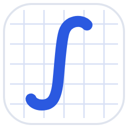

<h1 align="center">Лемма</h1>

Доска для уроков математики, физики и информатики. Для Windows 10 и 11.

<a href="https://github.com/leksi9/lemma/releases/latest/download/Lemma-Setup.exe"><b>⬇ Скачать Лемму (Lemma-Setup.exe)</b></a>

## Как установить

1. Нажмите ссылку **«Скачать Лемму»** выше. Скачается файл `Lemma-Setup.exe`.
2. Запустите его и нажмите «Далее». Права администратора не нужны.
3. Если Windows покажет окно «Windows защитила ваш компьютер», нажмите **«Подробнее» → «Выполнить в любом случае»**. Так бывает с программами без платной цифровой подписи.

Лемма появится в меню «Пуск» и на рабочем столе.

## Как обновить

Скачайте установщик по той же ссылке и установите поверх. Доски, ученики и темы уроков сохранятся.

## Что умеет

- Перо с нажимом для графического планшета, маркер, ластик, прямые линии с Shift
- Геометрические фигуры 2D и 3D, поворот и отражение
- Координатная плоскость с живыми графиками функций
- Таблицы: квадраты, тригонометрия, производные, системы счисления и другие
- Вставка страниц из PDF и картинок
- Папки по ученикам, дата урока, темы и поиск по ним

---

Файлы ниже — исходный код программы. Чтобы пользоваться Леммой, они не нужны.
